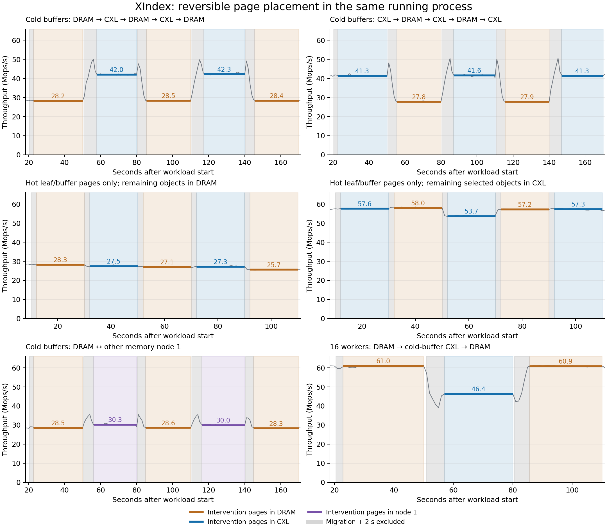
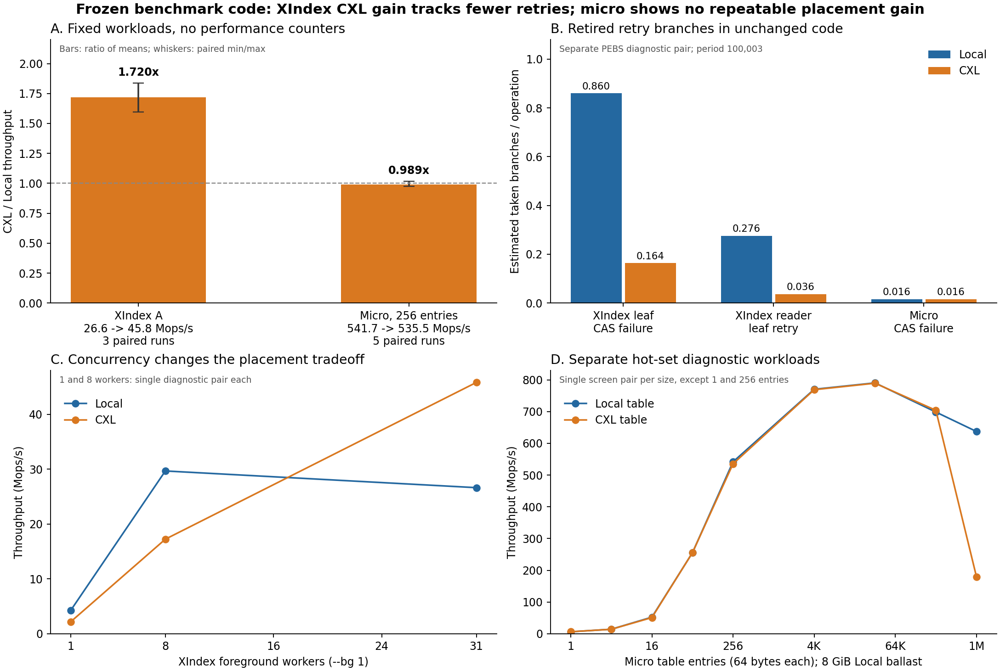
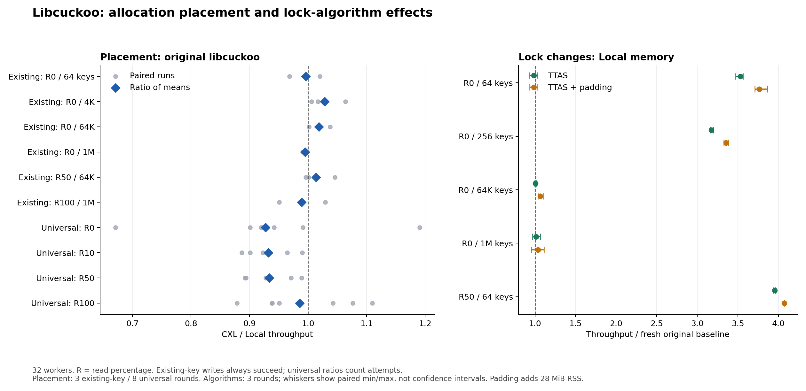

# Results and design history

Measurements below come from different revisions and protocols, not one pooled
experiment. Recent runs used a Xeon Gold 6548Y+, CPUs/DRAM on node 0, CXL on
node 2, LLVM 18 and jemalloc 5.2.1. Original rows, hashes and manifests are in
the [evidence index](../results/README.md). Current run instructions are in the
[benchmark guide](benchmarks.md).

## XIndex: changing cold-buffer placement changes contention (November 19)

Moving XIndex's hot leaf locks to CXL is **not necessary** for a large gain.
In a running process, moving the surrounding buffer pages to CXL increases
throughput by about 48%, while the hot leaf locks stay in DRAM. Moving those
pages back reverses the gain. This identifies an indirect effect of allocation
placement on contention; it does not establish that CXL services a hot lock
faster or that added latency is the only hardware cause.

The experiment freezes benchmark/library sources, input IR, existing binaries,
production runtime and selection policy at the inputs recorded from `bd7225e`.
An external controller reads object addresses and uses
[`move_pages`](https://man7.org/linux/man-pages/man2/move_pages.2.html) to change
physical placement. It never writes benchmark instructions or object contents.
Virtual addresses and the inspected tree topology remain identical across
phases. CPUs and ordinary memory use node 0; node 2 is the verified CXL target.
Background work is disabled. No new Arbiter selection parameter is introduced.

These are **duration-replay diagnostics**, using the existing 100M-load/400M-A
trace, 31 foreground workers and existing one-second throughput reporting.
They are not the earlier one-pass 400M-operation confirmations, and their
percentages must not be pooled or subtracted to decompose the earlier +72% gain.
Migration and two seconds afterward are excluded; each retained sample's whole
one-second interval lies inside the steady phase. Each process finishes with
the original placement restored, zero failed sampled reads, the expected state
digest, and zero allocation fallbacks or residency-query errors.

The buffer-only binary selects the existing site 68: 96-byte buffer objects,
containing tree pointers and metadata. It leaves leaf blocks and record arrays
in DRAM. Of 850,643 resident selected-arena pages, 11 pages associated with the
20 most frequent keys in the previous bounded trace sample stay put. The other
**850,632 pages (3.245 GiB)** move. "Cold" below means this exclusion, not proof
that every other page is infrequently accessed; extents also include allocator
metadata. None of the sampled top-20 leaf or record pages is moved.

| Initial buffer placement | Five consecutive steady phases, Mops/s | Intervention versus adjacent baselines |
|---|---|---|
| DRAM | **28.241 → 42.034 → 28.468 → 42.309 → 28.443** | Cold pages to CXL: **+48.24%, +48.69%** |
| CXL | **41.335 → 27.834 → 41.604 → 27.863 → 41.321** | Cold pages to DRAM: **−32.88%, −32.80%** |

Both rows use independent fresh processes and two reversible interventions.
The opposite starting placement addresses initialization/history as an
explanation. In the second row the hot buffer pages remain in CXL throughout;
all leaf locks still remain in DRAM.

Two additional controls use the original automatic-selection binary. Four of
the sampled top-20 keys use buffered leaves. Moving only their four leaf pages
and four buffer pages from DRAM to CXL gives **−0.61% and +3.43%** against
adjacent baselines, with noticeable baseline drift. Starting with all selected
objects in CXL, moving those eight hot pages back to DRAM preserves throughput:
**58.028 and 57.228 Mops/s**, versus adjacent baselines of roughly 54–58 Mops/s.
There is no comparable throughput collapse. These controls support the indirect
effect, but do not prove that every possible hot-object placement has zero effect.

The concurrency control is particularly revealing: with the **same buffer-only
binary and 16 foreground workers**, a DRAM → cold-CXL → DRAM crossover gives
**61.042 → 46.382 → 60.918 Mops/s**, a **23.94% regression** during CXL placement.
The 16-worker DRAM control even exceeds the 31-worker buffer-only CXL result.
This is one lower-concurrency crossover, not a search for the optimal worker
count. It supports a high-concurrency collapse being relieved by placement,
rather than CXL being intrinsically faster for this lookup path.

Moving the same excluded-hot buffer page set from node 0 to memory-only node 1
gives smaller gains of **6.04% and 5.33%**, again reversed by restoration.
Node 1's physical technology is not asserted. Its distance-table value is not
a measured access latency, and this control does not isolate CXL protocol from
different access costs or physical-address/home distributions.

A final partial-placement control moves a fixed random half of the eligible
cold pages (425,316 pages; seed 381119). Its five phases are
**27.810 → 32.461 → 27.886 → 32.452 → 27.916 Mops/s**: **+16.57% and +16.31%**
against adjacent baselines. It does not outperform complete cold-buffer placement
or sustain the approximately 50 Mops/s spikes seen during some migrations.
Those transient peaks remain excluded from every steady-throughput result.

Separate phase-aligned profiles connect this intervention to reduced retries.
All 31 worker TIDs appear in every phase and both recordings report zero lost
samples. Retired conditional branches and locked loads use period 100,003;
cycles use period 30,000,003. Event and operation denominators cover the same
whole one-second intervals, excluding transitions. The profile itself achieves
27.212/39.884 Mops/s and is not included in the unprofiled throughput rows.

| Estimated events per completed operation | Cold buffers in DRAM | Cold buffers in CXL |
|---|---:|---:|
| Failed outer leaf-lock CAS | 0.9376 | 0.5521 (**−41.1%**) |
| Reader retries a locked leaf | 0.3029 | 0.1612 (**−46.8%**) |
| Outer leaf-lock CAS attempts | 1.1055 | 0.7232 |
| Value CAS | 0.5052 | 0.4963 |
| All locked loads | 2.6031 | 2.2258 |

The retry change occurs in both CXL phases and reverses in all three DRAM
phases. The hottest leaf's CAS samples remain on its unchanged DRAM address.
Cycle samples in the outer TAS-loop region fall from 28.5% to 20.2%; estimated
total cycles per operation fall from 3,975 to 2,717. Ordinary cycle samples can
skid, so these are not precise critical-section times or waiter counts.

In a separate `ldlat=128`, period-10,007 memory profile, sampled **cache-access**
latency on the moved buffer pages rises from **271 to 1,674 cycles**. Samples
on the four hot leaf objects, which stay in DRAM, instead fall from **1,282 to
997 cycles**. The profile contains 1,026/894 cold-buffer samples and 5,830/3,333
hot-leaf samples in DRAM/CXL phases. These are conditional sample means, not
all-load averages or a direct measurement of physical memory-device latency.
On this processor `weight` is cache-access latency and `ins_lat` is instruction
latency; the eligibility threshold applies to the latter, so cache weights can
be below 128. The distinction follows the
[kernel PEBS decoder](https://github.com/torvalds/linux/blob/v6.8/arch/x86/events/intel/ds.c#L1742)
and [Intel's latency-field definitions](https://cdrdv2-public.intel.com/789573/252046-sdm-change-document.pdf).
The combination supports slower cold accesses moderating excessive contention,
while leaving cache/home effects as alternative or additional causes.
Instruction-latency means for the same sampled populations change from
402 to 1,800 cycles on cold buffers and from 11,584 to 8,106 cycles on hot leaves.
For the hottest leaf's outer CAS specifically, 3,049/1,600 selected samples
give 20,757/15,630 instruction cycles. These remain conditional distributions,
not average lock-acquisition times. Reported instruction latency is a 16-bit
field; 30 samples in the entire recording reach its maximum and are retained.
The per-field table also retains critical
key-load samples, but their small counts (50/38) do not support a precise
critical-section cost estimate.

The buffer root is read by `locate_leaf` **before** the outer leaf lock is
acquired. Each worker mixes hot-key requests with other requests from a very
large trace. Delaying those other requests can change how many workers contend
at once, even though the hot request's own buffer and leaf stay in DRAM. This
is a plausible form of implicit pacing between requests; it is not an inserted
software backoff, nor a measured count of simultaneous waiters.

Source inspection explains why equal write percentages are insufficient.
Both XIndex and the original libcuckoo use tight test-and-set-style atomic loops;
this is **not** a TAS-versus-TTAS comparison. XIndex additionally has optimistic
readers that retry a locked/version-changed leaf, and buffered writes hold an
outer leaf lock across value CAS and an explicit memory fence. The hottest
observed leaf's lock is at offset 1, its lookup keys share that cache line,
and its updated value is at offset 64 on the **next** line. A claim that this
particular value falsely shares the outer-lock line would be incorrect.

Libcuckoo instead locks candidate buckets for both reads and writes. Its
64-byte lock objects contain lock metadata; key/value buckets are separate.
In the existing-key test, the automatically moved allocation is the roughly
4 MiB lock array, while the approximately 36 MiB bucket array stays in DRAM.
XIndex's buffer-only intervention moves about 3.2 GiB along a much larger lookup
working set. The selected allocations therefore have different roles in the
path leading to contention, even though both benchmarks have real RMW/HitM risk.
The libcuckoo controls use 1M preloaded keys and uniformly choose from hot sets
of 1, 64 or 65,536 keys, with **100% successful value increments**. They do not
reproduce XIndex's mixture of highly popular keys and a huge cold-key population.
Furthermore, libcuckoo acquires its candidate locks **before** looking up and
updating the payload bucket. Moving cold payload buckets would add delay inside
that protected operation; it is not equivalent to moving XIndex's pre-lock
buffer access. This is a source-level distinction, not an isolated measurement
of the earlier growing-insert regression.

Separate five-second core-counter windows confirm the working-set difference.
They start after prefill/warmup and finish while every worker remains active:
31 for XIndex, 32 for libcuckoo. Every event has 100% running time. The XIndex
comparison is another cold-buffer crossover; libcuckoo uses fresh processes.

| Workload | L3 misses in Local / CXL window | L3 misses per 1,000 retired loads, Local / CXL |
|---|---:|---:|
| XIndex, buffer-only | 118,592,779 / 163,335,675 | 13.394 / 13.036 |
| Libcuckoo, 1 hot key | 7 / 0 | 0.0000134 / 0 |
| Libcuckoo, 64 hot keys | 4 / 0 | 0.000000523 / 0 |
| Libcuckoo, 65,536 hot keys | 1,065 / 1,207 | 0.00000630 / 0.00000721 |

XIndex's return-to-DRAM window gives 13.465 misses per 1,000 loads. These ratios
compare retired loads, not logical requests or direct memory-device transfers.
The higher absolute XIndex miss count during CXL placement reflects a faster
execution rate; the claim is reduced **retry work per completed operation**, not
less total memory traffic per second. Libcuckoo's measured accesses overwhelmingly
stay within the cache hierarchy, so moving its lock backing pages produces
little of the cold-access pacing seen in XIndex. The earlier full-count
write-heavy comparisons still provide its throughput conclusion: no consistent
CXL gain. This does not establish a result for every possible libcuckoo workload.

The measured placement interventions establish the indirect effect. Whether
its lowest-level trigger is access latency, cache pressure, physical-address/home
distribution, or a combination still requires distinguishing evidence; this
host does not allow the relevant uncore/system-wide measurements. In particular,
an increase in completed throughput also increases completed hot-key requests
per second. "Fewer hot requests arrive per second" is not a valid explanation;
reduced simultaneous waiting, burstiness or retry amplification are the relevant
hypotheses.

[Raw phases and controls](../results/placement-causality/20261119/phases.csv)
· [Retry estimates](../results/placement-causality/20261119/mechanism-summary.json)
· [Latency samples](../results/placement-causality/20261119/memory-summary.csv)
· [Cache counters](../results/placement-causality/20261119/cache-summary.csv)
· [Frozen inputs and validation](../results/placement-causality/20261119/checks.json)
· [Object layouts and source facts](../results/placement-causality/20261119/source-and-object-facts.json)

## Libcuckoo with actual writes (November 19)

Write percentage alone does not explain the missing CXL gain. This follow-up
uses unchanged original-library binaries from the previous investigation and
covers guaranteed value increments, successful inserts/deletes, and table growth.
Only the runner forwards additional existing upstream workload options; no
benchmark, library, compiler, runtime or selection-policy source is changed.
The frozen base is `5ad2815`; hashes and exact commands are retained.

The upstream universal benchmark's percentages count **attempts**. In the old
pure-update configuration (capacity `2^23`, prefill 75%, 32 workers, 4,194,304,000
requests), each worker has 524,288 candidate keys and 196,608 present keys.
Its full-period query sequence completes 250 cycles, so exactly **37.5%** of
attempts successfully update a present key, storing the same default value.
This fraction is derived from the pinned source and settings, not an added
counter. Workers have separate key sequences; different keys can share bucket
locks. Even read-only lookups acquire spinlocks. Upsert's existing-value callback
is empty, so an all-upsert run is not evidence of 100% payload modification.

The existing-key driver with `--reads 0` instead increments a present value on
every request. The final all-key sum equals the update count in every run,
with zero failures. Earlier experiments already included this kind of 100%
write workload; the new runs add smaller hot sets and structural mutations.
For 50% insert/50% erase, the initial per-worker population exceeds the maximum
50-operation batch imbalance, so both operation types always succeed. Pure
insertion always inserts fresh keys. The upstream runtime assertions remain
active under `-DNDEBUG` and validate those outcomes.

All comparisons use 32 workers, CPU/ordinary memory node 0, selected memory node
0 or CXL node 2, fixed counts and matched seeds within each pair, fresh processes,
and alternating placement order. There is no perf instrumentation in these rows
and no outlier removal. `schedutil` and boost remain enabled. Original update
and small-table churn cases use five pairs; other structural cases use three.
Calibrations select counts and are excluded. Three later native reference rounds
for hot-64, hot-65,536 and small-table churn are retained separately; they were
not interleaved with the paired comparisons and are only secondary references.

Means below are Mops/s; the percent is CXL/Local minus one. Brackets are the
complete observed paired range, **not** a confidence interval.

| Workload | Pairs | Local | CXL | Change [paired min, max] |
|---|---:|---:|---:|---:|
| 100% increments, 1 hot key | 5 | 0.876 | 0.873 | -0.34% [-12.35, +12.27] |
| 100% increments, 16 hot keys | 5 | 5.777 | 5.894 | +2.04% [-1.79, +5.46] |
| 16 hot keys, fresh-seed recheck | 5 | 5.882 | 5.775 | -1.83% [-8.34, +2.99] |
| 100% increments, 64 hot keys | 5 | 23.969 | 24.160 | +0.80% [-2.09, +2.84] |
| 100% increments, 65,536 hot keys | 5 | 528.375 | 527.921 | -0.09% [-1.16, +1.20] |
| 50% insert / 50% erase, capacity 2^20 | 5 | 282.968 | 290.607 | +2.70% [-1.49, +16.88] |
| 50% insert / 50% erase, capacity 2^23 | 3 | 212.254 | 174.978 | -17.56% [-44.54, -4.00] |
| 100% insert, growth from capacity 2^12 | 3 | 25.726 | 4.090 | -84.10% [-84.29, -83.91] |
| 100% insert, reserved 2^28; short control | 3 | 184.076 | 163.769 | -11.03% [-14.67, -8.67] |
| 100% insert, reserved 2^30; longer control | 3 | 179.221 | 165.891 | -7.44% [-9.03, -6.51] |

The apparent +2.70% small-table churn mean comes from **one positive pair out
of five**; the other four pairs are negative. The initial hot-16 +2.04% result
has four positive pairs out of five. A fresh-seed five-pair recheck reverses the
initial placement order and gives **-1.83%**, with 3/5 positive pairs: the small
initial gain does not reproduce. Keep the two batches separate. Large-table
churn is negative in all three pairs,
but its -17.56% mean is strongly affected by one -44.54% pair; the magnitude is
not a precise estimate. The growing-insert regression is consistent across all
three pairs, at roughly -84%.

The original update timings span 11.3–15.9 seconds. Structural churn takes
1.65–5.06 seconds, and growth takes 5.17–32.89 seconds across modes. Reserved
insertion initially takes only 0.71–0.83 seconds for 134,217,728 requests; retain
it as a short control. The longer reserved run quadruples capacity and request
count to 536,870,912 requests, uses fresh seeds and takes 2.96–3.28 seconds.
It is a distinct workload, not a count-matched comparison to the growth run.
[Summary and durations](../results/libcuckoo/write-heavy-20261119/summary.csv)
· [Every throughput row](../results/libcuckoo/write-heavy-20261119/runs.csv)

Existing-key runs execute selected lock site 26; universal runs without resize
execute lock site 43. Growing insertion additionally executes bucket-resize
site 51, with 23 selected allocations per process. Site 51 comes from the older
function/thread signals, not the new object-RMW evidence. Reserving capacity
leaves the bucket array in ordinary DRAM and only moves lock storage. It also
removes resizing work, so this control does not isolate site 51's causal cost.
Exit-resident selected pages are on the requested node and all fallback counts
are zero. Growth frees/purges bucket pages before the exit report; that report
is not a full census of every page while the workload was running.

Separate whole-process perf diagnostics provide a direct check of the lock
risk. Counts include initialization and validation, divided by timed requests;
these are neither exact failed-acquire counts nor hot-phase-only measurements.
Each counter reports 100% running time.

| Hot keys | Locked loads/request, Local → CXL | RFO HitM responses/request, Local → CXL |
|---|---:|---:|
| 1 | 83.824 → 90.152 | 27.963 → 29.279 |
| 65,536 | 2.023 → 2.021 | 1.897 → 1.870 |

For one hot key, 100% of locked-load address samples lie in the selected arena
in both modes. The corresponding retired L3 HitM-load samples are 99.97% Local
and 100% CXL. Sampling uses period 100,003, reports no lost events, and matches
successful `mbind` extents, including arena metadata rather than exact object
boundaries. These event classes do not measure all coherence traffic.
[Counters](../results/libcuckoo/write-heavy-20261119/counters.csv)
· [Address samples](../results/libcuckoo/write-heavy-20261119/address-samples.csv)

Thus the selected lock storage is a real RMW/HitM risk, while CXL placement
leaves the original test-and-set serialization in place. For the hot-one case,
the diagnostic counts do not show a reduction in locked operations or RFO HitM
responses. Write intensity and allocation-risk detection are insufficient to
predict a placement speedup. The earlier XIndex gain accompanies reduced lock
retries; the earlier micro 100%-write control still has no gain. These results
do not justify another selection parameter or a claim that arbitrary
write-heavy workloads will benefit.

All operation/placement checks pass. Runner validation covers five rejected
argument combinations and twelve real native/Local/CXL upstream smoke processes,
including legacy inferred updates, explicit updates, mixed operations and upserts.
[Checks and frozen hashes](../results/libcuckoo/write-heavy-20261119/checks.json)
· [Runner checks](../results/libcuckoo/write-heavy-20261119/runner-checks.json)
· [Evidence and reproduction](../results/README.md)

## Why XIndex benefits from CXL and the microbenchmark does not (November 19)

XIndex's CXL gain accompanies a sharp reduction in retries on a highly contended
leaf lock. The micro's correct table allocation is already selected, but moving
it to CXL does not reduce its retries or improve the fixed workload in fresh
confirmations. Additional selection parameters are not supported by this result.

This investigation freezes the benchmark code at `62b5367`: the microbenchmark
is the **already corrected 64-byte-entry / epoch-store version**, not the original
32-byte upstream version. No benchmark, compiler, production runtime or policy
source was changed. Allocation ablations rewrite only selected calls from the
same frozen input bitcode. A separate runtime copy tests interleaved extents;
its small patch is experimental evidence, not a production change.

Fresh confirmations use the complete XIndex A trace (100M load, 400M timed
operations, 31 foreground workers, `--bg 1`) and the existing micro default
(32 victims, 256 entries, 50% reads, 8 GiB ballast, no noise). CPUs and ordinary
memory stay on node 0; selected allocations use node 0 or CXL node 2.
Micro has five 30-second pairs; XIndex has three rounds, rotating nodes 0/2/1.
No performance counters run during these confirmations. Brackets are observed
ranges, not confidence intervals; percentage changes compare arithmetic means.

| Fixed workload | Runs per mode | Local Mops/s [min, max] | CXL Mops/s [min, max] | Change |
|---|---:|---:|---:|---:|
| XIndex YCSB-A | 3 | 26.620 [26.534, 26.714] | 45.793 [42.488, 48.776] | +72.02% |
| Micro, 256 entries / 32 workers | 5 | 541.668 [537.630, 545.381] | 535.452 [528.289, 546.415] | -1.15% |

### The difference is avoidable retry traffic, not missing micro allocation selection

XIndex's [leaf lock](../benchmark/xindex/XIndex-H/xindex_buffer_impl.h#L875)
repeatedly issues `cmpxchgb` until it succeeds, without a load/pause waiting
loop. Its [reader](../benchmark/xindex/XIndex-H/xindex_buffer_impl.h#L53) repeats
the lookup when the leaf is locked or its version changed. Precise retired
conditional-branch samples locate those retries in the unchanged executable:

| Estimated taken retry branches per completed operation | Local | CXL |
|---|---:|---:|
| XIndex leaf-lock CAS failure (`HGroup::put+0x279`) | 0.8600 | 0.1640 |
| XIndex reader sees a locked leaf (`AltBtreeBuffer::get+0x141`) | 0.2758 | 0.0363 |
| Micro table CAS failure (`victim_thread+0x18a`) | 0.01596 | 0.01597 |

These are separate PEBS diagnostics with period 100,003, not software counters
or throughput confirmation runs. XIndex's leaf CAS attempt samples likewise
fall from 1.0673 to 0.3205 per operation, while value CAS (~0.5/op) and the two
RCU progress sites combined (~1/op) remain. One leaf accounts for 85.2% of Local
leaf CAS samples. A bounded 1M-record trace sample has a most frequent key at
3.78%; it is not an exact distribution of the entire 400M trace.

The microbenchmark already waits on status loads with `pause` before CAS and
uses 64-byte entries. Its 16 KiB table fits easily in cache; all 256 table lines
receive locked-operation samples, with no line above 0.49% of those samples.
**99.71% / 99.73% of Local / CXL HITM address samples are in the selected table.**
The correct object is already selected. Locked loads stay near 0.516/op and
instructions near 67.4/op in both modes. Moving the backing pages does not
remove the required CPU cache ownership transfers, and these measurements show
no corresponding collapse in retries. HITM identifies sharing; it does not by
itself predict a CXL placement gain.

The micro imitates an individual value's version/status protocol; it does not
reproduce XIndex's extra **outer leaf lock** around buffered updates. It also
uses uniform table indexing and per-worker epoch stores, whereas this XIndex
trace is skewed and RCU progress uses an atomic increment. Thus equal write
percentages do not make their critical paths or contention patterns equivalent.
XIndex's reader also executes explicit memory fences where this micro uses
atomic acquire/relaxed loads; the benchmark is an approximation, not the same
instruction sequence with a different data structure.
The outer leaf lock, rather than the value CAS, is where the largest measured
retry reduction occurs.

Micro cycle samples concentrate around status reads, CAS and the ballast read.
Memory-stall counters remain around two thirds of cycles in both modes. These
events overlap, and ordinary cycle sample IPs can skid; their percentages are
not disjoint execution-time components. The micro also pays for RNG, indexing
and its large read working set. It is not a pure test of CXL load latency.

### Controls narrow the cause, but do not prove a CHA mechanism

The XIndex gain depends on concurrency. Single diagnostic Local/CXL pairs give
**4.254/2.185 Mops/s at 1 foreground worker** and **29.662/17.236 at 8 workers**.
At 31 workers with background disabled, Local/CXL are **27.617/53.973**;
32 foreground workers with background disabled give **25.391/52.654**.
CXL's extra access cost dominates at low concurrency; a reduction in excessive
retry traffic can outweigh it under the measured high-contention workload.

`--bg 1` creates both a busy coordinator and a maintenance worker. Instruction
sampling estimates 476.1/314.6 total instructions per operation, of which the
coordinator contributes 259.1/135.2 and maintenance 22.4/6.9. Remaining symbols
contribute 194.6/172.5. Most of the whole-process instruction decrease is thus
background work during a shorter run, not proof of fewer foreground retries.
The direct branch samples above and the background-disabled controls avoid
that interpretation error. Remaining symbols are not exclusively foreground.

Moving **only site 68's 96-byte buffer objects** improves a screening pair from
26.702 to 38.464 Mops/s. A separate profile/address check confirms that leaf
locks and value CAS still reside on node 0 in this control, and that leaf CAS
attempts decrease. The buffer contains root/begin pointers and metadata; in
existing-key A it is not the hot per-update lock itself. This supports an
**indirect timing/contention effect** from allocation placement, not just a
faster service path for a lock whose backing page was moved. Slower cold accesses
moderating contention is a plausible explanation; exact hardware arbitration
and queue behavior remain unmeasured. Traffic redistribution and address/home
effects are not separated by the available counters, so this is not a proof
that added latency alone causes the gain.

The host permits user core PMUs but denies system-wide/uncore access.
Consequently this experiment does **not** establish CHA queue occupancy,
memory-controller saturation or a particular CXL coherence route. Intel's
CHA IRQ terminology means *Ingress Request Queue*, not Linux interrupt counts.
[Intel core event definitions](https://perfmon-events.intel.com/platforms/emeraldrapids/core-events/core/)
and [uncore guide](https://cdrdv2-public.intel.com/817509/817509-EMR_XCC_UPG_Guide-Rev_001.pdf)
provide the event/queue definitions; they are not evidence that the inaccessible
hardware events occurred here.

### Placement search on unchanged default inputs

Each row below is an exploratory pair, except the confirmation table above.
Explicit site IDs are causal ablations, not new automatic selection parameters.

| Micro selected objects / setting | Local Mops/s | CXL Mops/s |
|---|---:|---:|
| Table only | 535.186 | 533.969 |
| Read-only ballast only | 543.514 | 53.935 |
| Table and ballast | 536.235 | 53.586 |
| Table, arena alignment 128 bytes | 539.019 | 538.497 |
| Table, arena alignment 4 KiB | 531.866 | 532.088 |
| Table, global jemalloc `thp:always` control | 545.263 | 546.565 |

Arena alignment changes allocation-base alignment, not the stride of entries
inside the table. The THP control actually backs about 8 GiB with huge pages
and reduces page-walker-active cycles from 37.3% to 10.0%, but does not produce
a large throughput gain. Walker activity is not an additive stall fraction.
This is a global allocator page-policy control, not a CXL speedup or a committed
runtime setting. Without ballast, the existing 50%-read workload runs at
784.302/785.305 Mops/s, and 0%-read at 582.384/581.931: ballast alone is not hiding
a table-placement gain. Those no-ballast inputs are separate workloads.

For XIndex, leaf-block-only (site 71) gives 25.008/38.176 Mops/s, buffer+leaf
(68+71) gives 26.223/45.726, active RCU allocation 25 gives 26.426/26.149, and
data array 38 gives 26.376/41.958. Site 71 is a **520-byte block containing five
104-byte nodes**, not one 520-byte leaf. Adding data array 38 to the automatic
eight sites gives only **25.958/26.780**: selecting more RMW-related storage can
destroy the existing gain. The automatic set remains `68,71,74,90,97,98,99,100`;
only 68/71/74 execute in this A trace. An initial site-2 RCU trial selected an
unused out-of-line constructor clone; it is excluded, and the active site-25
trial is retained separately.

An isolated runtime copy also interleaves only the selected extents over node 0
and another node, preserving the same benchmark bitcode, 32 workers, 256 entries,
write mix and ballast size. Full page counts check approximately equal residency
on the two requested nodes. Node 2 is the verified CXL target; node 1 is a
separate memory-only NUMA node whose physical technology is not asserted here.

| Selected objects | Interleaved nodes | Single-node Local Mops/s | Interleaved Mops/s | Change |
|---|---|---:|---:|---:|
| ballast | 0 + 1 | 533.462 | 499.638 | -6.34% |
| ballast | 0 + 2 | 533.462 | 127.890 | -76.03% |
| both | 0 + 1 | 546.665 | 493.182 | -9.78% |
| both | 0 + 2 | 546.665 | 127.445 | -76.69% |
| table | 0 + 1 | 543.893 | 540.024 | -0.71% |
| table | 0 + 2 | 543.893 | 544.938 | +0.19% |

The runtime patch is retained only as an experiment. It changes the meaning of
the target inside those isolated binaries; the production single-node binding
contract and runtime are unchanged.

### Changed-input checks are not default-workload improvements

Hot-set, worker-count, read-mix, ballast and noise sweeps keep source code fixed
but alter workload inputs. They are labeled separately in the archive. A
64 MiB table (1,048,576 entries) falls from 637.272 to 179.865 Mops/s when placed
in CXL: a large cold selected allocation can be expensive. Moving ballast to
CXL with a tiny hot table (1/4/16/64 entries) also fails to produce a useful
screen gain. The two largest apparent table-placement wins were retested on
fresh 30-second runs, five pairs each:

| Separate micro input | Runs per mode | Local Mops/s [min, max] | CXL Mops/s [min, max] | Change |
|---|---:|---:|---:|---:|
| Micro, one entry / 32 workers | 5 | 6.408 [6.136, 6.574] | 6.467 [6.279, 6.582] | +0.93% |
| Micro, 256 entries / 8 workers | 5 | 210.496 [209.603, 211.008] | 209.426 [208.671, 211.227] | -0.51% |

In a separate one-entry branch-sampling pair, writer load/pause wait-loop
branches remain high at 84.39/83.51 per operation, and CAS failures are
0.231/0.217. The tiny hot set creates substantial waiting, but CXL does not
produce the XIndex-like collapse in retry work. These are diagnostic samples,
not additional throughput confirmation rows.

These controls must not be reported as improvement of the unchanged
256-entry/32-worker baseline. The measurements support retaining the existing
XIndex selection and keeping the micro ballast local. More RMW parameters or
broader selection are not justified by this diagnosis; placement benefit also
depends on access concentration, retry behavior and cold-access cost.
Across the tested settings on this host and frozen version, no reproducible
placement-only improvement was found for the fixed micro workload.

Every accepted XIndex row executes 400M operations and matches the existing
4,096-key digest; micro validates reads+writes, versions and epochs. Residency,
zero fallback/query errors and zero swap are checked. Frozen-source/artifact
hashes and empty production-code diffs establish the scope. Two initial
multiplexed counter probes and the inactive RCU trial are excluded, but retained.
Precise load-latency samples are exploratory, not an all-load latency mean.
The host retains `schedutil`/boost; CPU caches are not flushed. Profiles,
single-pair screens and repeated throughput confirmations are not pooled.
[Evidence and reproduction files](../results/placement-diagnosis/20261119/)
· [Checks](../results/placement-diagnosis/20261119/checks.json)
· [Mechanism summary](../results/placement-diagnosis/20261119/mechanism-summary.json)

## Object RMW analysis and libcuckoo (November 19)

The extension recognizes the tested libstdc++ `std::thread` state and follows
allocation pointers through object fields, calls, list nodes and vector storage.
It reuses `WEIGHT_PUBLISHED_RMW`; **all policy values and the runtime are unchanged**.
Against clean main `21498d9`, the actual measured XIndex and microbenchmark
inputs produce **byte-identical rewritten bitcode**. XIndex keeps
`68,71,74,90,97,98,99,100`; micro keeps table site 4 and excludes ballast.
Site 90 gains object-RMW evidence but was already selected and is inactive in A.
The new analysis is bounded evidence discovery, not a proof of sharing or a
sound whole-program alias analysis; its ABI/scope limits are in the overview.
A field-load cache reduced one profiled XIndex analysis pass from 22.74 to
4.11 seconds (peak RSS 93.75→100.25 MiB). All eight measured input modules
retain identical selection reports and rewritten bitcode after this change.

Fresh regression runs used three native/Local/CXL rounds. XIndex executed the
complete 100M-load/400M-transaction A workload, 31 foreground + 1 background
worker; micro used three 30-second runs per mode, 32 victims, 256 64-byte entries,
epoch stores, 50% reads, 8 GiB ballast and no noise.

| Workload | Native Mops/s | Local Mops/s | CXL Mops/s | CXL / Local |
|---|---:|---:|---:|---:|
| XIndex YCSB-A | 26.953 | 26.401 | 46.641 | +76.66% |
| Coherence micro | 537.455 | 539.938 | 537.494 | −0.45% |

These are arithmetic means of three runs, not new gains attributable to this
compiler change: the rewrite/runtime equivalence is the regression evidence.
Every full XIndex run completed 400M operations and matched digest
`0x7474b8e9d3962859` over 4,096 keys. Selected residency, fallback/query checks
and zero-swap checks passed. Compiler fixtures, real callback/lambda cases,
runtime failure contracts, short XIndex state checks and micro operation-mix /
version / epoch checks passed as well.
[Regression checks](../results/libcuckoo/object-rmw-20261119/regression-validation.json)
· [Final rewrite equality](../results/libcuckoo/object-rmw-20261119/final-rewrite-equivalence.json)
· [XIndex rows](../results/libcuckoo/object-rmw-20261119/xindex-full-confirmed-runs.csv)
· [Micro rows](../results/libcuckoo/object-rmw-20261119/micro-regression-runs.csv)

Libcuckoo is pinned to upstream `0dd0b4d68fef76791a17950fde1a24f2328a58fe`.
The default build leaves the library and its universal benchmark unmodified.
In both tested drivers, existing-key read/update runs execute one selected
**4 MiB spinlock-array allocation**. The standalone driver selects site 26;
universal selects lock storage 43 plus resize-bucket site 51, which is inactive
without resizing. Site 51 comes from the existing function/thread signals,
not the new object-RMW evidence. Payload buckets and thread-result buffers stay
on node 0. Static selection and executed allocation are separate evidence.

The standalone driver makes every write an increment of an existing value,
then checks all keys, the complete value sum and unchanged hashpower after
workers finish. Universal checks operation success/failure against its own
expected key membership. Its percentages describe attempted operations;
read/update queries include absent keys and successful updates store the same
value. Even 100% reads acquire libcuckoo's locks. A separate all-insert run
checks resizing and strict placement with 2,097,152 successful insert requests
per mode; mixed insert/erase/read/update/upsert and all-upsert checks each run
409,600 requests per mode. All nine operation-validation runs pass. A short
native TTAS ThreadSanitizer check also passes; this is not a complete library
race proof. The complete upstream native unit suite passes for the original,
TTAS and TTAS+padded libraries as well.
[Validation](../results/libcuckoo/object-rmw-20261119/validation/)

Measurements use CPU/ordinary memory node 0, selected memory node 0 or CXL node 2,
32 workers, fresh processes, a 64 GiB/no-swap scope, and no perf counters during
throughput timing. The host retains `schedutil` and boost; CPU caches are not
flushed. Placement modes reverse on even rounds; each paired round uses the same seed.
Original-library confirmations use three existing-key rounds and eight universal
rounds (an initial three plus five additional runs for every mix after observing
variance). Algorithm confirmations rotate implementation order across three
rounds. No outliers are removed. The first sub-second screen is retained only
as exploratory history. Longer screens choose confirmation cases; confirmation
seeds differ.

Existing-key confirmations (three runs per mode, roughly 12–16 seconds each):

| Reads | Hot keys | Native Mops/s | Local Mops/s | CXL Mops/s | CXL / Local |
|---|---:|---:|---:|---:|---:|
| 0% | 64 | 23.89 | 24.00 | 23.91 | -0.39% |
| 0% | 4,096 | 470.65 | 467.92 | 481.26 | +2.85% |
| 0% | 65,536 | 521.13 | 519.93 | 529.69 | +1.88% |
| 0% | 1,048,576 | 530.87 | 556.93 | 554.04 | -0.52% |
| 50% | 65,536 | 535.39 | 532.95 | 540.26 | +1.37% |
| 100% | 1,048,576 | 649.86 | 644.73 | 637.81 | -1.07% |

Universal confirmations use capacity `2^23`, prefill 75%, and 4,194,304,000
requests per process. Each mix has eight runs per mode. Brackets show the
complete observed range, not a confidence interval.

| Read / update attempts | Native mean Mops/s | Local mean [min, max] | CXL mean [min, max] | CXL / Local |
|---|---:|---:|---:|---:|
| 0% / 100% | 311.50 | 299.49 [238.60, 314.41] | 277.68 [197.19, 296.21] | -7.28% |
| 10% / 90% | 293.67 | 304.08 [292.15, 309.59] | 283.50 [272.26, 289.33] | -6.77% |
| 50% / 50% | 292.33 | 291.71 [277.46, 297.79] | 272.33 [262.18, 277.22] | -6.64% |
| 100% / 0% | 310.10 | 298.44 [268.08, 319.16] | 294.15 [280.44, 298.28] | -1.44% |

These results do not establish a consistent libcuckoo placement gain. RMW-linked
allocation discovery works on these inputs, but moving backing pages does not
remove the need for CPU cache ownership transfers or lock acquisition.
[Placement means and paired ranges](../results/libcuckoo/object-rmw-20261119/placement-summary.csv)

A separate screen compared padding, adding `pause` to TAS, TTAS, and TTAS plus
padding. Held-out confirmation rotates the original, TTAS and TTAS+padded
implementations across three rounds, using the same operation count and seed
within each paired round. The following table uses **Local memory** throughout.

| Reads | Hot keys | Original Mops/s | TTAS Mops/s (ratio) | TTAS + padding Mops/s (ratio) |
|---|---:|---:|---:|---:|
| 0% | 64 | 24.21 | 85.47 (3.53×) | 91.18 (3.77×) |
| 0% | 256 | 56.79 | 180.28 (3.17×) | 190.59 (3.36×) |
| 0% | 65,536 | 527.83 | 531.53 (1.01×) | 562.49 (1.07×) |
| 0% | 1,048,576 | 542.88 | 549.25 (1.01×) | 562.86 (1.04×) |
| 50% | 64 | 23.99 | 94.78 (3.95×) | 97.70 (4.07×) |

TTAS waits using relaxed loads and `pause` after an unsuccessful acquire
exchange; successful acquisition and release retain acquire/release ordering.
It keeps the 64-byte lock layout and roughly 46 MiB Local RSS. Padding changes
72-byte buckets to 128 bytes and raises RSS by about 28 MiB to 74 MiB. The large
TTAS gain is concentrated in the small hot sets; the wide-key effects are much
smaller. These are **library algorithm/layout experiments, not CXL speedups**.
The default builder continues to use pristine upstream; experimental patches
and all native/Local/CXL rows are retained separately.
[Algorithm comparisons](../results/libcuckoo/object-rmw-20261119/algorithm-summary.csv)
· [Experimental patches](../results/libcuckoo/object-rmw-20261119/experimental-patches/)

Separate whole-process diagnostics use 32 workers, 64 hot keys, 100% updates
and 384M timed operations. Local locked loads per timed operation change from
5.064 to 2.327 with TTAS; RFO requests change 2.011→3.204,
and RFO HitM responses 1.531→1.162. These counts include setup and
validation, with 100% reported event running time; they are not hot-phase-only
measurements or uninstrumented throughput rows.
TTAS reduces locked loads and RFO HitM responses here, but total RFO requests
increase; the improvement is not a reduction in every coherence metric.
[Counters](../results/libcuckoo/object-rmw-20261119/counters.csv)
· [Intel core events](https://perfmon-events.intel.com/platforms/emeraldrapids/core-events/core/)
· [Intel offcore events](https://perfmon-events.intel.com/platforms/emeraldrapids/offcore-events/offcore/)

Address samples use period 100,003 and match addresses to successful `mbind`
extents of the selected arena (including its metadata, not an exact object
boundary). No lost events were reported.

| Variant / placement | Locked-load samples in arena | L3 HitM-load samples in arena |
|---|---:|---:|
| baseline / local | 100.00% | 79.02% |
| baseline / cxl | 100.00% | 79.80% |
| ttas / local | 100.00% | 83.01% |
| ttas / cxl | 100.00% | 83.69% |

The L3 event measures a particular class of retired HitM loads, not all
coherence traffic. Locked-load samples and RFO counts provide separate evidence.
[Sample counts and attribution](../results/libcuckoo/object-rmw-20261119/address-samples.csv)

The single-thread control measures 60.96 Local / 61.26 CXL Mops/s (+0.50%).
Disjoint-key control means are 656.82 / 564.83 (−14.01%), but CXL spans
346.15–675.10 Mops/s: one slow run dominates this three-pair mean. This is not
a precise effect estimate, and disjoint keys can still share bucket locks.
The full archive retains exploratory and confirmed stages separately, with
exact commands, binary hashes and validation output.
[Evidence index](../results/README.md)

## Current runtime: strict on-demand jemalloc

The runtime merged in #22 (`783706f`) removes the large pool, direct backend
and per-pointer side table while preserving NUMA placement and C/C++ failure
contracts. Runtime C++/headers fell from **1,294 to 650 physical lines**
(**−644, −49.77%**, including comments/blanks; compiler/tests counted separately).

The earlier allocator-finalization experiment ran exactly **one full Local/CXL
pair** on November 19:
100M load records, 400M transactions, 31+1 workers, 64 GiB limit, no swap.
That experiment had no fresh native baseline or additional repeats. The later
object-RMW regression above supplies fresh controls for the unchanged runtime.

| Implementation | Runs per placement | Local M tx/s | CXL M tx/s |
|---|---:|---:|---:|
| Bounded jemalloc, `9d90964` | 4 | 26.894 | 47.029 |
| Initial pool removal, 1,002-line runtime | 4 | 26.335 | 44.855 |
| Final strict runtime, 650 lines | 1 | 26.468 | 43.274 |

Final CXL/Local is **+63.49%**. Against the earlier bounded means, Local is
**−1.58%**, CXL **−7.98%**. This is a single observation against historical
controls, not proof of speedup, performance neutrality or a causal regression.
The initial pool-removal comparison also decreased: −2.08% Local, −4.62% CXL;
its CXL runs ranged from 40.970 to 48.088 M tx/s. The intermediate 552-line
strict-only runtime was not benchmarked; failure-contract handling brought it
to the final 650 lines.
[Final rows](../results/xindex/ycsb-a/jemalloc-strict-20261119/runs.csv)
· [Repeated comparison](../results/xindex/ycsb-a/jemalloc-demand-20261118/runs.csv)

Both final runs completed 400M transactions, made 52,791,182 selected
allocations at sites 68/71/74, and matched the 4,096-key digest
`0x7474b8e9d3962859`. All 5,000,778 located private pages were on the requested
node; six kernel zero pages were counted separately. Allocation-failure logs,
fallbacks, query errors and swap were zero. Policy and workload were unchanged;
rewritten IR matched after normalizing the new helper dispatch and debug data.

Peak RSS was 31.993 GiB versus the earlier bounded mean of 32.051 GiB
(about 58.8 MiB lower). Arena private residency stayed about 19.08 GiB.
Mapped backing grew from 20,587,741,184 to 23,578,279,936 bytes as jemalloc
chose its own growth sizes. Removing a 24 GiB virtual reservation did **not**
free 24 GiB of RSS. Initial pool-removal lifecycle timings also increased:
Local 5.510→5.680 s, CXL 5.340→5.630 s (three runs per cell). These include
page faults, NUMA queries, sorting and threads, not just allocator latency.

## Earlier allocator and XIndex results

**Custom slab → bounded jemalloc, November 17:** two full runs per allocator
and placement, with the same rewritten bitcode and eight runs total.

| Measurement | Custom slab | Bounded jemalloc | Change |
|---|---:|---:|---:|
| Local M tx/s | 27.27 | 27.36 | +0.31% |
| CXL M tx/s | 45.05 | 48.59 | +7.86% |
| Resident arena GiB | 17.31 | 19.08 | +10.21% |
| Peak process RSS GiB | 30.20 | 32.05 | +6.14% |

jemalloc rounds 520-byte objects to 640 bytes versus the slab's 576 bytes,
accounting for about 1.57 GiB of the 1.77 GiB arena increase. Correctness and
placement checks passed. In a separate five-process-per-cell allocation/release
check, median Local time rose 1.36→4.83 s and CXL 1.86→4.97 s; whole-process
timing includes touch/query/sort/thread work. Few repeats and host variation
limit conclusions. [Measurements](../results/xindex/ycsb-a/jemalloc-20261117/)

**Historical slab results:** full one-pass runs, except the explicitly archived
cyclic sweeps. A is approximately 50% reads/50% updates; F maps updates to
same-worker get/put. Throughput is millions of logical transactions/s.

| Experiment | Repeats | Native | Local | CXL | CXL/Local change |
|---|---:|---:|---:|---:|---:|
| A raw-046, October 20 ablation control | 4 pairs | — | 26.287 | 50.324 | +91.53% paired mean |
| A sites 68+71, after delete-ABI/correctness fixes | 4 pairs | — | 27.685 | 49.917 | +80.42% paired mean |
| F automatic policy, counter-free loop | 4 rounds | 33.983 | 33.953 | 50.681 | +49.27% ratio of means |

F's CXL/native gain was +49.14%. It extends workload coverage on XIndex, not
coverage of a new data structure. Earlier A ablations measured +46.35% for
site 68 alone, +50.78% for site 71, and +90.79% together. Site 71's leaf blocks
accounted for 14.16 GiB; site 74 used only one 2 MiB slab with no detectable
extra gain. This motivated reducing size from a dominant +6 score to a +1
tiebreaker while preserving the same automatic XIndex selection.
[A ablation](../results/xindex/ycsb-a/site-ablation-20261020/comparison.csv)
· [ABI confirmation](../results/xindex/ycsb-a/runtime-correctness-20261021/runs.csv)
· [F counter-free runs](../results/xindex/ycsb-f/counterfree-20261022/runs.csv)

**Read-heavy boundary:** archived YCSB-B (95% reads/5% updates) had 15
runtime-valid policies; every one-pair screen regressed with CXL, **−19.18%
to −45.34%**. None passed the promotion threshold; no repeated confirmation
followed. These are directional results, not precise per-policy effect sizes.
[Screen](../results/xindex/ycsb-b/fulltrace-sweep-20261008/screen-summary.csv)

## B-tree and coherence microbenchmark

The supplied B-tree times **600M read-only lookups** after construction.
It has no write-ratio option, and its structural insert/delete routines lack
a concurrent-write protocol. Its shared parallel RNG/accumulator also limit
repeatability. The current pass cannot rewrite its `posix_memalign` calls:
automatic selection is empty, so Local/CXL labels do not imply moved objects.
An earlier explicit node-array placement lost **50.67%** (22.24→10.97 M
lookups/s, three runs per mode); that manual path was removed. An automatic
check measured 23.02 native, 22.88 Local and 22.72 CXL with all pages local.
[Targeted runs](../results/btree-coherence/20261118/runs.csv)
· [Automatic runs](../results/allocation-policy/published-rmw-20261118/benchmark-runs.csv)

The published-RMW policy selects only the microbenchmark's shared table:

| Object | Timed access / HITM risk | Placement |
|---|---|---|
| Table (`g_table`, site 4) | CAS-protected writes; true sharing on the same entry and adjacent-entry false sharing at 32 bytes | Selected Local/CXL |
| Ballast (`g_ballast`, site 5) | Read-only after initialization; memory traffic without a continuing writer | Local |
| Victim results / thread state | Private accumulation then exit publication, or setup/teardown | Local |
| Epochs (`g_epochs`) | One writer per aligned counter; maintenance readers can share it | Static, outside allocation selection |
| Start/stop/spin flags | Mostly startup/shutdown coordination | Static, outside allocation selection |

Original weights gave table and ballast identical evidence. The new global
publication-to-pointee-RMW signal distinguishes them; runtime flags such as
100% reads cannot change a compile-time selection. Four full A pairs per policy
preserved XIndex: evidence-balanced CXL 46.34 vs published-RMW 46.30 M tx/s
(−0.08%), with byte-identical rewritten executables. Local was 27.50 vs 26.69;
all 16 rows passed validation. This is bounded-jemalloc evidence, not a new
confirmation of the final runtime.
[Decisions](../results/allocation-policy/published-rmw-20261118/decisions.csv)
· [XIndex rows](../results/allocation-policy/published-rmw-20261118/xindex-runs.csv)

The corrected adapter fixes 100%-read threshold overflow, lock acquisition
that admitted multiple writers, and non-atomic shared accesses. It validates
write totals/versions, released locks and epochs outside timing. Original
synchronization results remain historical, not correctness baselines.

Three 30-second Local/CXL pairs per variant used 32 victims, 256 entries,
50% reads, 8 GiB ballast and no noise. No counters ran during these timings.

| Corrected variant | Local Mops/s | CXL Mops/s | Local vs corrected control |
|---|---:|---:|---:|
| 32-byte entries, epoch RMW | 347.79 | 353.73 | — |
| 32-byte entries, epoch store | 375.10 | 375.46 | +7.85% |
| 64-byte entries, epoch store | 541.70 | 538.32 | **+55.76%** |

The first control Local run was slower; against its latter two runs the gain
is about 53%. The control's apparent +1.71% CXL advantage did not repeat;
padded CXL/Local was −0.63%. Padding doubles the table from 8 to 16 KiB;
RSS stays about 8.05 GiB. This is a workload optimization, **not a CXL speedup**.
[All 18 rows](../results/coherence-tuning/20261118/confirm.csv)

Separate 15-second hot-phase counters show locked loads/op fall from 1.5130
to 0.5142 with epoch stores; padding reduces Local HitM loads/op from 0.4332
to 0.3788. Address samples attributed 99.65–99.88% of mixed-workload HitM loads
to the table, and all sampled L3 misses to ballast. This supports selecting
the table, but moving its backing pages does not remove CPU cache ownership
transfers. The event counts L3 HitM loads, not all coherence traffic.
[Counters](../results/coherence-tuning/20261118/counters.csv)
· [Address samples](../results/coherence-tuning/20261118/hitm-samples.csv)
· [Intel event definition](https://perfmon-events.intel.com/platforms/emeraldrapids/core-events/core/)

Exploratory larger working sets worsened CXL performance: a 32 MB table lost
65.81% in the screen, and moving ballast lost about 87% in the earlier policy
screen. Cached metadata/power-of-two indexing regressed padded throughput
10.73% Local / 9.29% CXL and was removed. All 88 tuning rows passed workload
and placement checks; a short TSan check reported no races. Six-second screens
are exploratory and changes to mix/size are different workloads.

## Design history

| Step | What we learned / retained |
|---|---|
| Generic shared-mutable placement | Did not improve over all-site placement; direct per-object mapping inflated memory. Node-policy OOM motivated protected runs. |
| Lock-touch migration | Hooks alone cost about 8.9%; tested migration settings stayed below native. Prefer allocation-time selection. |
| Packed custom slab | Avoided per-object page waste; site-99 pilots led to automatic scoring and broad policy sweeps. |
| Seed-only policy | Removed ineffective member expansion and unused search controllers; retained configs and measured evidence. Cyclic sweeps later gave way to one-pass comparisons. |
| Correctness and A/F | Preserve matching new/delete ABI; add sampled-state and placement checks, then remove extra per-operation counters from performance loops. |
| jemalloc (#18), additional benchmarks (#21) | Delegate allocation management; add published-RMW evidence and corrected microbenchmark adapters. |
| On-demand extents (#22) | Remove fixed pool/direct fallback; keep strict NUMA, diagnostics and allocation API failure contracts. |

Throughput alone does not prove reduced HITM, and small-table contention does
not guarantee useful CXL placement. Old plans, full writeups and removed code
remain in [Git at 783706f](https://github.com/minchurl/arbiter/tree/783706f/docs);
the evidence index names earlier executable snapshots where needed.
